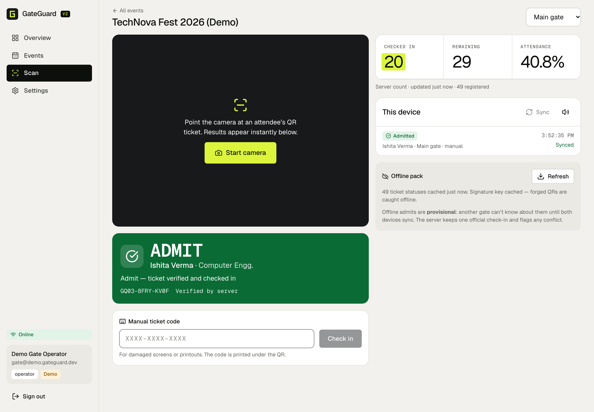
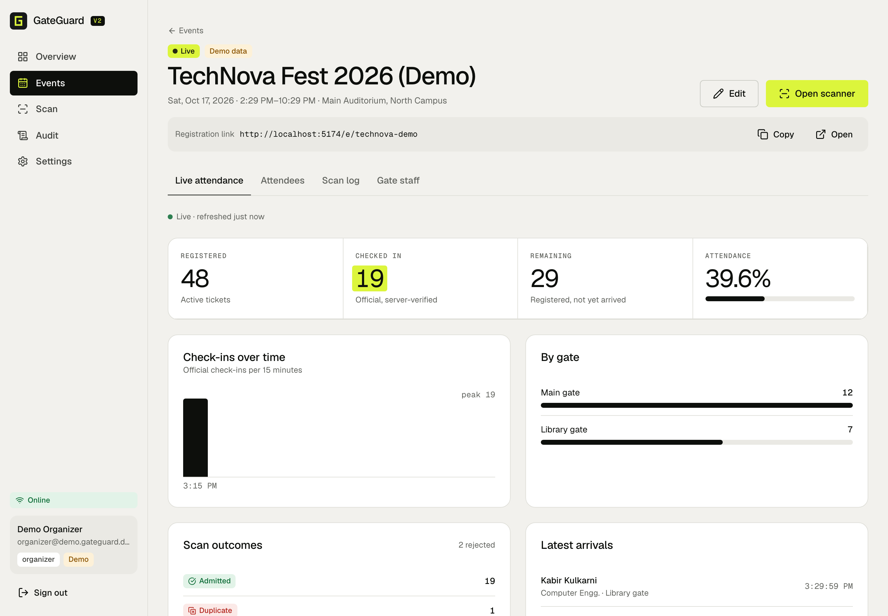
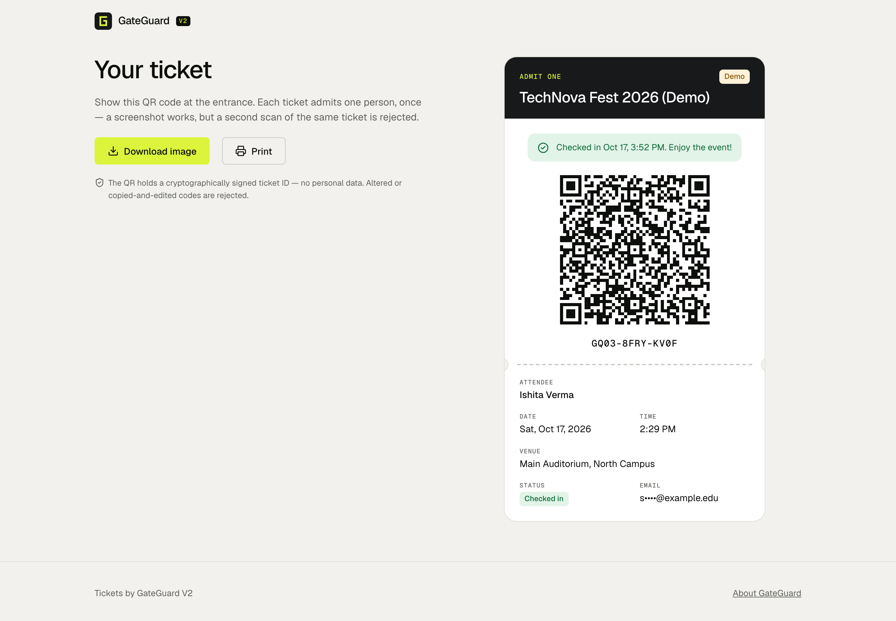
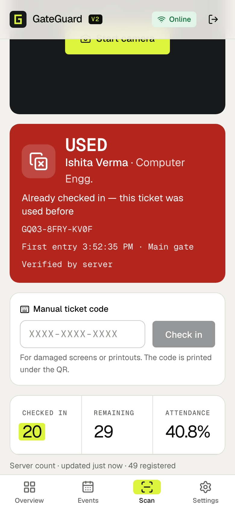

# GateGuard V2

**College event registration, cryptographically signed QR tickets, and fast, duplicate-proof gate check-in — with live attendance and an honest offline mode.**

- **Live app:** _see “Deployment” below for the current URL_
- **Demo logins:** `organizer@demo.gateguard.dev` / `gate@demo.gateguard.dev`, password `gateguard-demo` (shared, fictional data)



| Live attendance | Attendee ticket | Phone scanner |
| --- | --- | --- |
|  |  |  |

---

## What it does

| Requirement | How GateGuard V2 meets it |
| --- | --- |
| **Unique QR tickets** | Each registration gets a 60-bit random ticket code (`XXXX-XXXX-XXXX`, Crockford base32). The QR encodes `GG2.<eventId>.<code>.<Ed25519 signature>` — no personal data. Tickets can be downloaded as a PNG or printed. |
| **Real camera scanning** | `getUserMedia` + the native `BarcodeDetector` where available, otherwise ZXing WebAssembly (bundled, works offline). Start/stop, camera switching, permission/busy/no-camera errors, manual code entry, sound + vibration, and a same-code guard so a QR held in view is submitted once. |
| **Accurate live attendance** | Counts come from MongoDB (`countDocuments`/aggregations over tickets), refreshed every 3 s on scanner and event pages, 5 s on the dashboard. Per-gate breakdown, 15-minute timeline, recent arrivals. |
| **Fake / duplicate rejection** | Distinct, labelled outcomes: `ADMIT`, `USED` (duplicate — shows first entry time and gate), `FORGED` (bad signature), `WRONG EVENT`, `UNKNOWN`, `CANCELLED`, `INVALID` (not a GateGuard code), plus `ADMIT*` (provisional offline), unauthorized operator (403) and expired session. Every verdict has a word and an icon, not just a colour. |
| **Concurrency** | One atomic `findOneAndUpdate({ status: 'valid' } → 'checked_in')`. Tested: 25 simultaneous scans of one ticket → exactly 1 admit, 24 duplicates. |

Also: organizer dashboard with operational alerts, event create/edit, public registration pages with capacity limits (race-safe), duplicate-email prevention, CSV import/export (with formula-injection guard), ticket cancel/reinstate, role-based staff assignment, scan log with filters, administrative audit log, installable PWA.

## Architecture

```
client/  React 19 + Vite + TypeScript PWA (react-router, TanStack Query, lucide icons, qrcode, barcode-detector/zxing-wasm, idb)
server/  Express 5 + TypeScript + Mongoose 9 (zod validation, JWT session cookie, bcrypt, helmet, express-rate-limit)
api/     Vercel Function entry — exports the Express app
```

```
 Attendee phone ──► /e/:slug  register ──► POST /api/public/events/:slug/register ──► Ticket{code} (+ signed QR)
 Gate phone (PWA) ─ camera/manual ─► IndexedDB queue ─► POST /api/events/:id/checkin {scanId,…}
                                                          │  atomic valid→checked_in, Scan log (unique scanId)
 Organizer ◄── polling /stats, /dashboard ◄───────────────┘
```

In production one Vercel project serves both: static files from `client/dist`, and `/api/*` from the Express app as a Vercel Function. Same origin means no CORS and `SameSite=Lax` cookies.

### Data model (MongoDB)

| Collection | Purpose | Key indexes |
| --- | --- | --- |
| `users` | admin / organizer / operator accounts (bcrypt hashes) | `email` unique |
| `events` | event details, gates, `ownerId`, `staff[]`, `capacity`, `activeTickets` counter | `slug` unique, `ownerId`, `staff` |
| `tickets` | one per registration: attendee fields, `code`, `status` (valid / checked_in / cancelled), check-in time/gate/operator/scanId | `code` unique, `{eventId,email}` unique, `{eventId,status,checkedInAt}` |
| `scans` | every scan attempt with result, gate, operator, device time, server time, offline + conflict flags | `scanId` unique, `{eventId,receivedAt}` |
| `audits` | administrative actions (sign-ins, edits, cancellations, exports, staff changes) | `at` |

Consistency assumptions: a check-in is a single-document atomic update, so no multi-document transactions are needed. Attendance counts are always derived from `tickets` and never from a separately incremented counter. `activeTickets` is used only for race-free capacity reservation. A `scans` record is written after the ticket transition. If the process dies between the two, the check-in stands and the scan log misses one row. A retry with the same `scanId` returns the correct `accepted` result.

## Offline mode and reconciliation

1. When the scanner opens online, it caches the **Ed25519 public key** and an **offline pack**: ticket codes and statuses only, no names or emails, refreshed every 60 s.
2. Every scan is written to IndexedDB **before** it is sent, with a client-generated `scanId`.
3. If the server can't be reached, the device decides locally. It checks the format, the signature (WebCrypto Ed25519 with the public key), the event, cancelled or already-checked-in status from the pack, and this device's own earlier scans. Accepted tickets show **`ADMIT*` — provisional**.
4. Pending scans survive reloads and sync oldest-first: on reconnect, every 15 s, or on "Sync". `scanId` makes retries idempotent. Server or network errors keep a scan pending; a refused request (403/401) is marked failed and offers **Retry**.
5. The server applies the same atomic check-in. A provisional admit that loses is stored as **`conflict: true`** and surfaces as a dashboard alert, an "Offline conflict" badge and a scan-log filter.

**Limitation (by design):** two gates that are *both* offline cannot see each other's scans, so both may provisionally admit the same ticket. GateGuard never claims otherwise. After sync there is still **at most one official check-in**, and the other attempt is flagged for staff. The signing secret never leaves the server; the browser only has the public key.

## Security and privacy

- Session: HS256 JWT in an `httpOnly`, `SameSite=Lax`, `Secure` (production) cookie, 12 h. The user is reloaded on every request, so disabling an account takes effect immediately.
- Authorization is enforced server-side on every route. Admins manage everything. Organizers manage their own events and create operator accounts. Operators can only scan, and see live counts for events they're assigned to (no attendee emails). There is no public sign-up; the first admin comes from the seed script.
- Input validation with zod on every body and query, with consistent error shape `{ error: { code, message, fields? } }`.
- Rate limits: sign-in 20 per 15 min, public registration 15 per 10 min per IP, check-in 300 per min per operator, API 600 per min.
- Login is timing-safe against account enumeration (dummy bcrypt compare). `helmet` headers. CORS only for an explicit allow-list.
- Tickets: 60 random bits plus an Ed25519 signature. The QR carries no PII. The ticket page masks the email. The code is the bearer secret for the ticket page.
- CSV export neutralises spreadsheet formulas. The service worker never caches `/api` responses.
- **Not implemented (known gaps):** email delivery of tickets, password reset by email, 2FA, CSRF tokens (relies on `SameSite=Lax` plus JSON-only APIs), and a distributed rate-limit store. Limits are per serverless instance.

## Running locally

Requirements: Node 22+ (24 recommended) and MongoDB 7+ on `localhost:27017`.

```bash
npm install
cp .env.example .env
npm run keys            # prints JWT_SECRET and TICKET_SIGNING_KEY — paste them into .env
npm run seed            # indexes + admin (ADMIN_EMAIL/ADMIN_PASSWORD) + labelled demo workspace
npm run dev             # API http://localhost:3002/api, web http://localhost:5174 (proxied /api)
```

Database name defaults to `gateguard_v2_dev`. The camera needs `localhost` or HTTPS.

### Environment variables

| Variable | Where | Notes |
| --- | --- | --- |
| `MONGODB_URI` | server | Atlas connection string in production (include the database name, e.g. `/gateguard_v2`) |
| `JWT_SECRET` | server | ≥ 32 random bytes |
| `TICKET_SIGNING_KEY` | server | Ed25519 PKCS8 DER, base64 (`npm run keys`). Rotating it invalidates all issued QR codes. |
| `CORS_ORIGINS` | server | only for cross-origin frontends; same-origin deploys need none |
| `ADMIN_EMAIL`, `ADMIN_PASSWORD` | seed | first admin account |
| `SEED_DEMO`, `DEMO_PASSWORD` | seed | demo workspace on/off and its shared password |

## Tests

```bash
npm test -w server        # 23 API integration tests (Vitest + Supertest + mongodb-memory-server)
npm test -w client        # 10 unit tests: payload parsing, Ed25519 verification, offline decisions, queue sync/retry
npm run e2e -w client     # 6 Playwright tests against the production build + service worker (needs local MongoDB)
```

The end-to-end suite scans a **real QR through the camera pipeline**. Chromium's fake capture device plays an MJPEG rendered from a freshly issued ticket. It covers:

- one admit while the QR stays in view, then `USED`, `FORGED` and `INVALID` rejections;
- camera-permission denial;
- reloading the scanner offline (served by the service worker), provisional admits, and sync on reconnect;
- two offline gates reconciling to one check-in plus a flagged conflict;
- phone-width overflow and console errors.

The server suite covers the 25-way concurrency race, idempotent retries, capacity races, authorization, validation, CSV import/export and cancellation.

## API

All endpoints are under `/api`, take JSON and return JSON. Errors look like `{ error: { code, message, fields? } }`.

| Method & path | Who | Purpose |
| --- | --- | --- |
| `GET /health` | public | `{ ok, db }` — 503 if MongoDB is unreachable |
| `POST /auth/login` · `POST /auth/logout` · `GET /auth/me` | — | session cookie (`/auth/me` returns `user: null` when signed out) |
| `POST /auth/password` | signed in | change password |
| `GET/POST /users`, `PATCH /users/:id` | admin, organizer | list/create accounts, disable/enable |
| `GET /dashboard` | signed in | events in scope, totals, last-hour outcomes, recent scans, alerts |
| `GET/POST /events`, `GET/PATCH /events/:id` | scoped | events (create/edit: admin, organizer) |
| `PUT /events/:id/staff` | owner | assign gate staff |
| `GET /events/:id/stats` | staff | live counts, outcomes, per gate, timeline, recent check-ins and scans |
| `POST /events/:id/checkin` | staff | `{ scanId, payload, gate, method, scannedAt?, offline?, provisional? }` → verdict |
| `GET /events/:id/manifest` | staff | offline pack (codes and statuses only) |
| `GET/POST /events/:id/attendees`, `POST …/attendees/import`, `PATCH …/attendees/:code`, `GET …/attendees/:code/qr` | owner | attendees, CSV import, cancel/reinstate, QR payload |
| `GET /events/:id/scans` | staff | paginated scan log (`?result=`, `?conflict=1`) |
| `GET /events/:id/export/attendees.csv` · `scans.csv` | owner | CSV export |
| `GET /audit` | admin, organizer | administrative audit log |
| `GET /public/events/:slug` · `POST …/register` | public | registration page data, register |
| `GET /public/tickets/:code` · `GET /public/ticket-key` | public | ticket page, Ed25519 public key |

## Deployment

Production runs on **Vercel**, with the static frontend and the Express API as a Vercel Function in region `bom1`. The database is **MongoDB Atlas**. `vercel.json` holds the build command, output directory, rewrites and security headers. Steps:

1. Create an Atlas cluster and a database user. Allow network access from Vercel; serverless egress IPs aren't fixed, so `0.0.0.0/0` is used, protected by the credentials.
2. In the Vercel project set `MONGODB_URI`, `JWT_SECRET`, `TICKET_SIGNING_KEY` and `NODE_ENV=production`.
3. Run `npm run seed` once with production env vars to build indexes and create the admin and demo data.
4. `vercel deploy --prod`, then check `GET /api/health`.

## Design

The visual direction comes from Refero style research. The foundation follows Ramp's editorial finance desk: a warm bone canvas, hairline borders instead of shadows, and one high-visibility accent reserved for primary actions, live counters and the active state. The monospace treatment for labels, codes and metric captions comes from Vercel's style. The accent is a hi-vis yellow-green, chosen for the vests gate volunteers wear. Verdict colours appear only together with a word and an icon. Type is Geist and Geist Mono, self-hosted so the app works offline. Motion is limited and respects `prefers-reduced-motion`.

## Known limitations

- Physical-device testing: the scanner was verified end-to-end with Chromium's fake camera fed a real ticket QR, plus unit tests. Low-light performance, autofocus and older-iPhone behaviour on real hardware still need hands-on testing.
- Offline duplicate prevention across disconnected gates is impossible by nature. See *Offline mode* above.
- No email or SMS delivery. Attendees save or print the ticket page, and organizers can open any attendee's ticket.
- The live view polls every 3–5 s instead of pushing over SSE or WebSockets. This is simple, and it is reliable on serverless instances that don't share memory.
- The demo workspace is shared and anyone can change its data. Demo accounts can't create users or change passwords.

## License

[MIT](LICENSE). Chosen so colleges and student clubs can reuse and adapt it freely.
